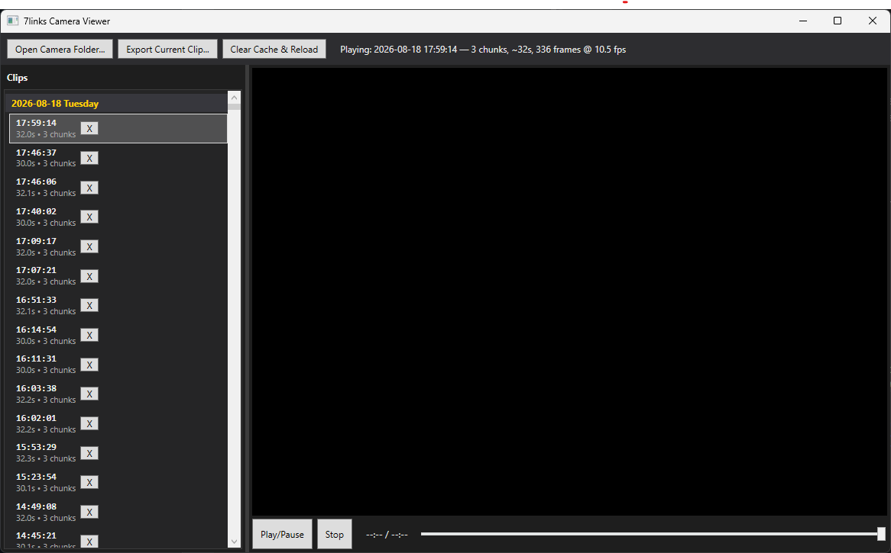

# 7links Camera Viewer

> A small Windows desktop app to browse, play and export clips from **7links** trail / wildlife cameras that store recordings as proprietary `.media` chunk files.

[](https://github.com/maumau61/SevenLinksViewer/actions/workflows/ci.yml)
[](LICENSE)
[](https://dotnet.microsoft.com/)
[](#)

7links cameras don't write ordinary `.mp4` files. Each recorded event lands in its own
folder as a sequence of `NNNN.media` chunks — a raw **HEVC (H.265)** bitstream wrapped in
an undocumented 24-byte-per-record container. Standard players can't open them. This app
reverse-engineers that container, stitches the chunks back into a clean HEVC stream, remuxes
it to MP4 on the fly, and plays it back — so you can actually watch what your camera caught.

---

## Features

- 📂 **Point it at your SD card** (or any folder containing `DCIM/`) and it finds every event automatically.
- 🗓️ **Clips grouped by day**, sorted newest-first, with duration and chunk count.
- ▶️ **Instant playback** — chunks are concatenated, cleaned and remuxed to MP4 behind the scenes (via a bundled, auto-downloaded ffmpeg) and played with LibVLC.
- 💾 **Export to MP4** — save any clip as a standard `.mp4` that plays anywhere.
- 🗑️ **Delete events** straight from the list (handles the camera's read-only files).
- 🔁 **Robust to firmware changes** — the `.media` header format shifts between firmware generations; the parser is written to survive those bumps (see [docs/media-format.md](docs/media-format.md)).

## Screenshot



---

## Getting started

### Requirements

- **Windows 10/11**
- **[.NET 8 SDK](https://dotnet.microsoft.com/download/dotnet/8.0)** (to build) or the .NET 8 Desktop Runtime (to run a published build)
- An internet connection on first launch — the app downloads a portable ffmpeg (~30 MB) into your temp folder once.

### Build & run from source

```powershell
git clone https://github.com/maumau61/SevenLinksViewer.git
cd SevenLinksViewer
dotnet run --project src/SevenLinksViewer
```

### Publish a self-contained build

```powershell
dotnet publish src/SevenLinksViewer -c Release -r win-x64 --self-contained
# output: src/SevenLinksViewer/bin/Release/net8.0-windows/win-x64/publish/
```

### Usage

1. Launch the app and click **Open Camera Folder…**
2. Select your camera's root folder (the one containing `DCIM/`, e.g. the SD card).
3. Pick a clip from the day-grouped list on the left — it starts playing on the right.
4. Use **Export Current Clip…** to save it as a portable `.mp4`.

The app remembers the last folder you opened.

---

## How it works

A recorded event is a folder named `<unix-timestamp>_<id>/` containing `0000.media`,
`0010.media`, … chunks. Each `.media` file is a stream of records:

```
[ 24-byte record header ][ HEVC Annex-B payload ]  [ 24-byte header ][ payload ]  …
```

The pipeline:

1. **Crawl** (`MediaCrawler`) — walk `DCIM/`, group chunks into events, derive start time from the folder name and duration from a timestamp field in the headers.
2. **Concatenate & clean** (`MediaConcatenator`) — detect each record header, copy out only the HEVC payload (skipping audio fragments and padding), and insert an end-of-sequence NAL between chunks so the decoder resets cleanly.
3. **Remux** (`FFmpegService`) — wrap the raw HEVC in an MP4 (`-c:v copy`, no re-encode) with a synthesized frame rate.
4. **Play / export** — LibVLC plays the cached MP4; export just copies it out.

The full reverse-engineered container format — including the firmware-dependent flag byte
that has broken playback more than once — is documented in
**[docs/media-format.md](docs/media-format.md)**.

## Project structure

```
SevenLinksViewer.sln
├─ src/SevenLinksViewer/      WPF desktop app (.NET 8, WPF, LibVLCSharp)
│  ├─ Models/EventClip.cs         one recorded event
│  ├─ Services/MediaCrawler.cs    discovers events under DCIM/
│  ├─ Services/MediaConcatenator.cs   parses .media, emits clean HEVC
│  ├─ Services/FFmpegService.cs   downloads ffmpeg, remuxes to MP4
│  └─ MainWindow.xaml(.cs)        UI
└─ src/MediaProbe/            CLI tool for inspecting .media files
                             (NAL/header dumps — used to diagnose new firmware)
```

### MediaProbe (diagnostics)

When a new firmware generation stops playing, `MediaProbe` dumps the header fields and NAL
layout of a `.media` file so the new format can be worked out:

```powershell
dotnet run --project src/MediaProbe -- "path\to\event-folder"
```

---

## Contributing

Issues and PRs welcome — especially sample headers from new firmware generations that break
playback. See [CONTRIBUTING.md](CONTRIBUTING.md).

## Tech

- [.NET 8](https://dotnet.microsoft.com/) / WPF
- [LibVLCSharp](https://github.com/videolan/libvlcsharp) — video playback
- [Xabe.FFmpeg](https://github.com/tomaszzmuda/Xabe.FFmpeg) — ffmpeg download & remux

## License

[MIT](LICENSE) © 2026 Mau Mau

> Not affiliated with, or endorsed by, 7links / PEARL. "7links" is a trademark of its
> respective owner. This is an independent, interoperability tool for footage you recorded
> yourself.
